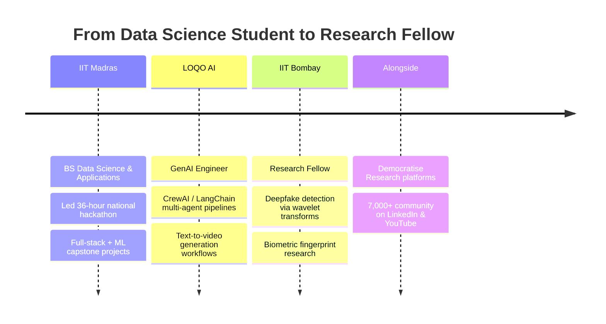

<!-- ============================================================= -->
<!--              PREM KUMAR SHARMA  ·  GITHUB PROFILE             -->
<!-- ============================================================= -->

<div align="center">
  
</div>

<div align="center">
  <a href="https://github.com/prem-kumar-sharma">
    
  </a>
</div>

<p align="center">
  <a href="https://www.linkedin.com/in/prem-kumar-a499b1201/"></a>
  
  
  
</p>

<div align="center">
  
</div>

<!-- ============================================================= -->
<!--                          ABOUT ME                             -->
<!-- ============================================================= -->

##  About Me

<table>
<tr>
<td width="58%" valign="top">

```python
class PremKumarSharma:
    """Research Fellow · GenAI Engineer · Builder"""

    def __init__(self):
        self.role      = "Research Fellow @ IIT Bombay"
        self.prev      = "GenAI Engineer @ LOQO AI"
        self.education = "BS Data Science, IIT Madras"
        self.research  = ["Deepfake Detection",
                          "Wavelet Transforms",
                          "Biometrics"]
        self.building  = ["Multi-Agent Pipelines",
                          "Video RAG",
                          "Text-to-Video"]
        self.stack     = ["Python", "PyTorch", "LangGraph",
                          "FastAPI", "Next.js", "Docker"]
        self.community = "7,000+ on LinkedIn & YouTube"
        self.contact   = "premksharma@alumni.iitm.ac.in"

    def say_hi(self):
        print("Let's build something intelligent!")

me = PremKumarSharma()
me.say_hi()
```

</td>
<td width="42%" valign="top" align="center">
  
  <br/><br/>
  
  
  <br/>
  
  
</td>
</tr>
</table>

- 🔭 **Currently:** Research Fellow @ **IIT Bombay** — deepfake detection & biometric fingerprints via wavelet transforms
- 💼 **Previously:** GenAI Engineer @ **LOQO AI** — CrewAI / LangChain multi-agent pipelines & text-to-video workflows
- 🎓 **Alumnus:** **IIT Madras** — BS in Data Science & Applications
- 🚀 **Leadership:** Led a 36-hour national hackathon at IIT-M; **7,000+** community on LinkedIn & YouTube
- 🧩 **I like problems that span the whole stack** — from signal processing math down to the Dockerfile that ships it
- 🌱 **Currently learning:** Diffusion fine-tuning, MCP servers, vector DB internals
- 💬 **Ask me about:** RAG, LangGraph, CrewAI orchestration, research workflows, shipping ML to production
- 📫 **Reach me at:** <a href="mailto:premksharma@alumni.iitm.ac.in">premksharma@alumni.iitm.ac.in</a>

<!-- ============================================================= -->
<!--                         JOURNEY                               -->
<!-- ============================================================= -->

## 🧭 My Journey So Far



<!-- ============================================================= -->
<!--                      WHAT I'M DOING                           -->
<!-- ============================================================= -->

## 🔬 What I'm Working On

<table>
<tr>
<td width="33%" valign="top">

### 🧪 Research
Deepfake detection and biometric identification using **wavelet transforms** and deep learning — finding the frequency-domain fingerprints that generative models can't hide.

`PyTorch` · `OpenCV` · `Signal Processing`

</td>
<td width="33%" valign="top">

### 🤖 Agentic AI
Multi-agent orchestration for real workloads — retrieval, planning, tool use and video generation pipelines that run unattended.

`LangGraph` · `CrewAI` · `FastAPI`

</td>
<td width="33%" valign="top">

### 🌐 Research Platforms
Building and shipping the **Democratise Research** ecosystem — making Indian research funding, papers and programmes easy to find.

`Next.js` · `TypeScript` · `Vercel`

</td>
</tr>
</table>

<!-- ============================================================= -->
<!--                     FEATURED PROJECTS                         -->
<!-- ============================================================= -->

## 🚀 Featured Projects

### 🤖 Generative AI & LLM Systems

<table>
<tr>
<td width="50%" valign="top">

#### 🎥 [Video RAG Pipeline](https://github.com/prem-kumar-sharma/video_rag_project)
End-to-end video understanding: extracts audio, transcribes with **Whisper**, samples frames, auto-captions them, and answers questions with **timestamped** retrieval — so every answer points back to the exact second it came from.

<sub>`Python` · `Whisper` · `faster-whisper` · `ffmpeg` · `Streamlit`</sub>

</td>
<td width="50%" valign="top">

#### 🎯 [Intent Classifier Service](https://github.com/prem-kumar-sharma/train_intent_classifier)
A production-shaped NLP microservice — training pipeline, feature store, inference API and a Streamlit console, with **Prometheus** metrics and Docker baked in from day one.

<sub>`FastAPI` · `scikit-learn` · `Docker` · `Prometheus` · `Streamlit`</sub>

</td>
</tr>
<tr>
<td width="50%" valign="top">

#### 📄 [Chat With Your Resume](https://github.com/prem-kumar-sharma/Chat_with_your_resume)
Upload a PDF résumé and interrogate it in natural language. Text extraction via **PyMuPDF**, answers grounded in the document through GPT models.

<sub>`Streamlit` · `OpenAI` · `PyMuPDF`</sub>

</td>
<td width="50%" valign="top">

#### 🧾 [PDF Document Extractor](https://github.com/prem-kumar-sharma/Pdf-Extractor)
Pulls document type, number and date out of single- or multi-document PDFs — **digital and scanned alike**. Handles invoices, POs, GRNs, bills of lading, packing lists and credit/debit notes via OCR + LLM extraction.

<sub>`Python` · `OCR` · `LLM Extraction`</sub>

</td>
</tr>
<tr>
<td width="50%" valign="top">

#### 🗣️ [SQL Generation Pipeline](https://github.com/prem-kumar-sharma/sql_gen_pipeline)
Natural-language → SQL generation pipeline, paired with [**SQL-Chat**](https://github.com/prem-kumar-sharma/SQL-Chat) for conversational querying of relational databases.

<sub>`Python` · `LLMs` · `SQL`</sub>

</td>
<td width="50%" valign="top">

#### 🧠 [Diabeteasy — ML Health](https://github.com/prem-kumar-sharma/ML-Health-Project)
Diabetes risk prediction with auth, a prediction form, **doctor recommendations via Google Maps API** and a medication tracker — an ML model wrapped in an actual product.

<sub>`Flask` · `scikit-learn` · `Google Maps API`</sub>

</td>
</tr>
</table>

### 🌐 Web Platforms & Products

<table>
<tr>
<td width="50%" valign="top">

#### 🔭 [Democratise Research Hub](https://github.com/prem-kumar-sharma/democratise-hub)
The landing page and apex router for **democratiseresearch.in** — a data-driven tile grid plus Vercel path-proxying that stitches several independent projects onto one domain.

<sub>`Next.js` · `TypeScript` · `Vercel`</sub> · [🔗 Live](https://democratiseresearch.in)

</td>
<td width="50%" valign="top">

#### 🏛️ [ANRF Conclave Page](https://github.com/prem-kumar-sharma/ANRF-Conclave-Page)
Single-page site for the **ANRF Research Impact Conclave** series, built with the App Router and deployed on the edge.

<sub>`Next.js` · `TypeScript` · `Tailwind`</sub> · [🔗 Live](https://anrf-conclaves.vercel.app)

</td>
</tr>
<tr>
<td width="50%" valign="top">

#### 📚 [SARAL Resources](https://github.com/prem-kumar-sharma/saral-resources) & [Research Papers](https://github.com/prem-kumar-sharma/saral-research-papers)
Searchable, zero-backend resource and paper libraries for the SARAL initiative — fast static sites driven by JSON data layers.

<sub>`JavaScript` · `HTML/CSS` · `Vercel`</sub> · [🔗 Live](https://saral-resources.vercel.app)

</td>
<td width="50%" valign="top">

#### 🎓 [EduBridge LMS](https://github.com/prem-kumar-sharma/Edubridge)
A user-centric LMS built with the **KDT-EAST** framework: attendance automation, assignment workflows, real-time messaging and performance dashboards — researched with real user interviews and journey maps.

<sub>`Vue` · `Python` · `Figma` · `Jira`</sub>

</td>
</tr>
<tr>
<td width="50%" valign="top">

#### 📖 [Library Management System](https://github.com/prem-kumar-sharma/Library-Management-System)
Full-stack library platform with role-based access, issue/return flows and admin reporting.

<sub>`Vue` · `Flask` · `SQLite`</sub>

</td>
<td width="50%" valign="top">

#### 💸 [Smart Expense Splitter](https://github.com/prem-kumar-sharma/Smart-Expense-Splitter-Android-application)
Native Android app for splitting group expenses, backed by Firebase for sync and auth.

<sub>`Kotlin` · `Firebase` · `Gradle`</sub>

</td>
</tr>
<tr>
<td width="50%" valign="top">

#### 🧰 [QR Generator](https://github.com/prem-kumar-sharma/QR-Generator)
QR codes two ways — a fully **client-side** web app (nothing ever uploaded) and a CLI with scale, border and colour control, auto-sizing the QR version with level-M error correction.

<sub>`JavaScript` · `Python` · `qrcode`</sub>

</td>
<td width="50%" valign="top">

#### 💼 [Portfolio Website](https://github.com/prem-kumar-sharma/my-portfolio)
My hand-rolled portfolio — no framework, no build step, just fast static pages.

<sub>`HTML` · `CSS` · `JavaScript`</sub> · [🔗 Live](https://prem-kumar-sharma.github.io/my-portfolio/)

</td>
</tr>
</table>

### 📊 Data Science & Analytics

<table>
<tr>
<td width="50%" valign="top">

#### 🍽️ [Predicting Food Ratings](https://github.com/prem-kumar-sharma/Machine-Learning-Project-Predicting-Food-Ratings)
Recipe-rating prediction from user comments, ratings and recipe metadata across multiple joined datasets — feature engineering on messy, real text.

<sub>`Jupyter` · `scikit-learn` · `Pandas`</sub>

</td>
<td width="50%" valign="top">

#### 🏪 [BDM Capstone](https://github.com/prem-kumar-sharma/BDM-Capstone-Projects)
Operational analytics for a real grocery & dairy store in Patna — inventory management and customer-preference analysis, turned into decisions the owner could act on.

<sub>`Python` · `Excel` · `Business Analytics`</sub>

</td>
</tr>
<tr>
<td width="50%" valign="top">

#### 📣 [Ad Exposure Analysis](https://github.com/prem-kumar-sharma/Ad-Exposure-Analysis)
Study of how advertisement frequency shapes consumer behaviour — survey design, statistical testing and interpretation.

<sub>`Statistics` · `Data Analysis`</sub>

</td>
<td width="50%" valign="top">

#### 🗄️ [SQL Data Analysis](https://github.com/prem-kumar-sharma/SQL-Project)
Analytical SQL project — window functions, CTEs and joins doing the heavy lifting instead of a notebook.

<sub>`SQL` · `PostgreSQL`</sub>

</td>
</tr>
</table>

<div align="center">
  <a href="https://github.com/prem-kumar-sharma?tab=repositories">
    
  </a>
</div>

<!-- ============================================================= -->
<!--                        TECH STACK                             -->
<!-- ============================================================= -->

## 🛠️ Tech Stack & Tools

### 🤖 Generative AI · LLMs · Agents
<p>
  
  
  
  
  
  
  
  
  
  
  
</p>

### 🧠 ML · Deep Learning · Data Science
<p>
  
  
  
  
  
  
  
  
  
</p>

### 💻 Web & Frameworks
<p>
  
  
  
  
  
  
  
  
  
</p>

### ☁️ Infra · Databases · Tools
<p>
  
  
  
  
  
  
  
  
  
  
  
  
  
</p>

<!-- ============================================================= -->
<!--                   CONTENT & COMMUNITY                         -->
<!-- ============================================================= -->

## 🎬 Content & Community

<table>
<tr>
<td width="60%" valign="top">

I don't just build — I **teach**. Through **Insight by Prem** on YouTube and my writing on LinkedIn, I break down AI research, agentic systems and data science for a community of **7,000+** learners and practitioners.

- 📺 **YouTube:** deep dives on GenAI, RAG and research workflows
- ✍️ **LinkedIn:** notes from the lab, project breakdowns, career guidance for data science students
- 🎤 **Events:** led a **36-hour national hackathon** at IIT Madras
- 🧑‍🏫 **Mentoring:** résumé reviews and project guidance for IITM students

</td>
<td width="40%" valign="top" align="center">

<a href="https://www.youtube.com/@insightbyprem">
  
</a>
<br/>
<a href="https://www.linkedin.com/in/prem-kumar-a499b1201/">
  
</a>
<br/><br/>


</td>
</tr>
</table>

<!-- ============================================================= -->
<!--                       GITHUB STATS                            -->
<!-- ============================================================= -->

## 📊 GitHub Analytics

<div align="center">
  
  
</div>

<div align="center">
  
  
</div>

### 🏆 Achievements
<div align="center">
  
  
</div>

<div align="center">
  
</div>

### 📈 Activity Graph
<div align="center">
  
</div>

### 🐍 Contribution Snake
<div align="center">
  
</div>

<!-- ============================================================= -->
<!--                          QUOTE                                -->
<!-- ============================================================= -->

## 💭 Words I Build By

<div align="center">

> *"The best way to predict the future is to invent it."*  
> **— Alan Kay**


</div>

<!-- ============================================================= -->
<!--                       LET'S CONNECT                           -->
<!-- ============================================================= -->

## 🤝 Let's Connect

<div align="center">

**Open to** research collaborations · GenAI consulting · speaking · and interesting problems in general.

<a href="https://www.linkedin.com/in/prem-kumar-a499b1201/" target="_blank">
  
</a>
<a href="https://www.youtube.com/@insightbyprem" target="_blank">
  
</a>
<a href="https://instagram.com/prem.kr_sharma" target="_blank">
  
</a>
<a href="https://www.hackerrank.com/viratprem4321?hr_r=1" target="_blank">
  
</a>
<a href="https://prem-kumar-sharma.github.io/my-portfolio/" target="_blank">
  
</a>
<a href="mailto:premksharma@alumni.iitm.ac.in">
  
</a>

</div>

<br/>

<div align="center">
  <i>⭐ If something here helped you, a star on the repo makes my day.</i>
</div>

<div align="center">
  
</div>
