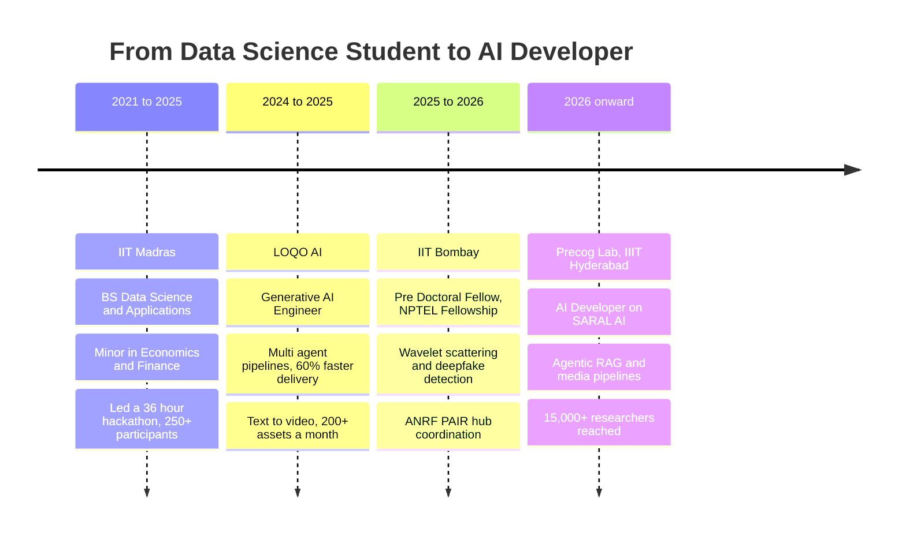

<!-- ============================================================= -->
<!--              PREM KUMAR SHARMA  ·  GITHUB PROFILE             -->
<!-- ============================================================= -->

  

  

  
  
  
  

  

<!-- ============================================================= -->
<!--                          ABOUT ME                             -->
<!-- ============================================================= -->

##  About Me

<table>
<tr>
<td width="60%" valign="top">

I build AI systems that people actually use, then I teach how they work.

Right now I am an **AI Developer (Research Associate)** at **Precog Lab, IIIT Hyderabad**, working on **SARAL AI**: a platform that turns dense research papers into podcasts, videos and slide decks. It serves **15,000+ researchers**, has processed **22,000+ papers**, and keeps **73% of its users coming back**.

Before this I spent a year as a **Pre-Doctoral Fellow at IIT Bombay** on the NPTEL Post-Baccalaureate Fellowship, working with Prof. Vikram M. Gadre on wavelets and time frequency methods for deepfake detection and fingerprint matching. Before that, I architected multi agent GenAI pipelines at **LOQO AI**.

I like problems that run the full depth of the stack: the signal processing maths at the top, the retrieval and evaluation logic in the middle, and the Dockerfile that ships it at the bottom.

</td>
<td width="40%" valign="top" align="center">
  
    
  
   
  
   
  
   
  
</td>
</tr>
</table>

- 🔭 **Now:** AI Developer (Research Associate) at **SARAL AI**, Precog Lab, IIIT Hyderabad, with Prof. Ponnurangam Kumaraguru
- 🔬 **Before:** Pre-Doctoral Fellow at **IIT Bombay**, Dept. of Electrical Engineering, with Prof. Vikram M. Gadre
- 💼 **Before that:** Generative AI Engineer at **LOQO AI**, intern to full time
- 🎓 **Education:** **IIT Madras**, BS in Data Science and Applications, minor in Economics and Finance
- 🧑‍🏫 **Alongside:** mentoring at Geekashram, and teaching Python, SQL and data science to anyone who will listen
- 🌱 **Learning:** diffusion fine tuning, MCP servers, vector database internals
- 💬 **Ask me about:** agentic RAG, hybrid retrieval, LLM evaluation and guardrails, research workflows, shipping ML to production

  

<!-- ============================================================= -->
<!--                       IMPACT NUMBERS                          -->
<!-- ============================================================= -->

  

 

 

<!-- ============================================================= -->
<!--                      CURRENT FOCUS                            -->
<!-- ============================================================= -->

## 🔬 What I Work On

<table>
<tr>
<td width="33%" valign="top">

### 🤖 Agentic AI Systems
Citation grounded agentic RAG over national research funding programmes. Classifier first routing, threshold gated hybrid retrieval over BM25 and pgvector, and a bounded tool calling agent whose answers must clear a validator that rejects unknown citations and unsupported figures.

`LangGraph` · `pgvector` · `FastAPI` · `Gemini`

</td>
<td width="33%" valign="top">

### 🎬 Media Pipelines at Scale
Fault tolerant multi stage pipelines over Redis Streams that turn a paper into a narrated video and an editable deck: LLM scene planning, image generation, text to speech and FFmpeg composition, with heartbeats, parallel stages and per scene retries.

`Redis Streams` · `FFmpeg` · `Go` · `GCP`

</td>
<td width="33%" valign="top">

### 📡 Signals and Explainability
Wavelets and time frequency methods meeting machine learning: wavelet scattering features for deepfake detection and fingerprint minutiae matching, plus SHAP attributions to probe image models treated as black boxes.

`PyTorch` · `OpenCV` · `SHAP` · `Wavelets`

</td>
</tr>
</table>

  

<!-- ============================================================= -->
<!--                          JOURNEY                              -->
<!-- ============================================================= -->

## 🧭 The Road So Far

<!-- ============================================================= -->
<!--                        TECH STACK                             -->
<!-- ============================================================= -->

## 🛠️ Tech Stack

### 🤖 LLMs, Agents and Retrieval

  
  
  
  
  
  
  
  
  
  
  
  

### 🧠 Machine Learning and Signals

  
  
  
  
  
  
  
  
  

### 💻 Languages and Systems

  
  
  
  
  
  
  
  
  
  

### ☁️ Infrastructure, Data and Security

  
  
  
  
  
  
  
  
  
  

  

<!-- ============================================================= -->
<!--                   ACHIEVEMENTS & OUTREACH                     -->
<!-- ============================================================= -->

## 🏆 Recognition and Outreach

<table>
<tr>
<td width="50%" valign="top">

- ⭐ **SARAL AI Star**, a Letter of Appreciation from the CEO, ANRF
- 🎪 Represented SARAL AI at **IndiaFOSS 2026**, India's national free and open source software conference
- 🎤 Invited **guest speaker** at **VGU Jaipur** and **IIIT Delhi**

</td>
<td width="50%" valign="top">

- 🏁 Led a **36 hour hackathon at IIT Madras** with 250+ participants
- 🥇 **Top 7 teams** at the IIT BHU 48 hour hackathon
- 🧑‍🎓 Taught and mentored **2,000+ students** across classrooms, online mentorship and hackathons

</td>
</tr>
</table>

<!-- ============================================================= -->
<!--                   CONTENT & COMMUNITY                         -->
<!-- ============================================================= -->

## 🎬 Insight by Prem

<table>
<tr>
<td width="62%" valign="top">

I do not just build, I **explain**. On YouTube as **Insight by Prem** and in my writing on LinkedIn, I break down AI research, agentic systems and data science careers for an audience of **20,000+**.

- 📺 **YouTube:** deep dives on GenAI, retrieval and how research actually gets done
- ✍️ **LinkedIn:** notes from the lab, system breakdowns, career guidance for data science students
- 🧑‍🏫 **Mentoring:** taking students from their first program to applied AI, project by project

</td>
<td width="38%" valign="top" align="center">

 

  

</td>
</tr>
</table>

  

<!-- ============================================================= -->
<!--                       GITHUB STATS                            -->
<!-- ============================================================= -->

## 📊 GitHub Analytics

  
  

  
  

  

  

<!-- ============================================================= -->
<!--                          QUOTE                                -->
<!-- ============================================================= -->

## 💭 Words I Build By

> *"The best way to predict the future is to invent it."*
>  **Alan Kay**

<!-- ============================================================= -->
<!--                       LET'S CONNECT                           -->
<!-- ============================================================= -->

## 🤝 Let's Connect

 

 

  <i>⭐ If something here helped you, a star makes my day.</i>

  

